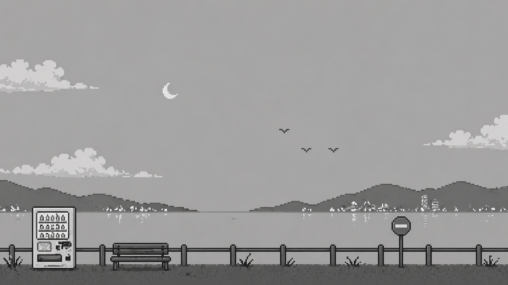

<!--
---
event_date: "2026-11-21"
recorded_at: "2026-11-21 03:36:23"
domain: "work"
type: "component"
client: "codex"
author: "co-authored"
agent_role: "portfolio_editor"
status: "active"
superseded_by: null
---
-->

**English** · [中文](./README.zh.md)

# spike

**Building products where people and their agents work together.**

Everyday tasks. Resume creation. Coding workflows. 
Thoughtful interfaces for people. Clear context and boundaries for agents.

[Personal site](https://bihangchi9-creator.github.io/spike-zone/) · [Try Folio](https://resume.puppytodo.ai/) · [GitHub](https://github.com/bihangchi9-creator)

---

## Selected work

### 01 / Folio
**A resume workspace for you and your agent.** 
`Web / PWA Beta` · `Private source` · `Collaborative project`

Build and edit your resume in a dedicated workspace. Your own external agent
reads its structure and versions, then submits a batch of proposed changes
for you to review. **You keep the final say.**

No built-in chatbot or model calls — the product provides the workspace;
the intelligence comes from the agent you already use.

[Open the workspace ↗](https://resume.puppytodo.ai/) · [Public Agent Skill ↗](https://github.com/suntianchong/folio-resume-skill)

The public Skill is maintained in a collaborator's repository. The product source remains private.

### 02 / 点点 · Diandian
**A shared task workspace for people and agents.** 
`In development` · `Private source` · `Collaborative project`

A lightweight to-do interface for people, with an agent-friendly layer for
reading tasks, carrying out work and returning results. Task state, history
and human confirmation make the handoff visible — not another chat to lose track of.

Built on Vikunja, with a custom interface and agent collaboration layer.
Account work, production deployment and broader device validation are still in progress.

Private work in progress; no public demo or source link yet.

### 03 / Lark Agent Bridge
**Bring your local coding agent into Feishu / Lark.** 
`Open source` · `TypeScript` · `DSH / CLI / IDE adapters`

One group, one conversation, one pinned runtime. Connect DSH, CLI agents,
an IDE window or a custom adapter to the place your team already talks —
without silently switching to another runtime when a connection fails.

[Explore the source ↗](https://github.com/bihangchi9-creator/lark-agent-bridge)

---

## What I care about

- **A shared workspace, not just a chat box.** People and agents should work
  from the same objects, versions and task state.
- **Human control where it matters.** Proposed changes should be reviewable;
  consequential actions need explicit decisions.
- **Good products before AI integrations.** The interface should be useful
  on its own, with clear contracts for the agent you choose.

## Earlier explorations

[**trae-to-lark**](https://github.com/bihangchi9-creator/trae-to-lark) —
an earlier standalone bridge connecting TRAE CLI, Claude Code and Codex to Lark.

[**Spike Zone**](https://bihangchi9-creator.github.io/spike-zone/) —
my personal site, with a scroll-driven 3D scene, adapted from an open-source template.
[Source](https://github.com/bihangchi9-creator/spike-zone)

---

Product thinking · TypeScript · Human–agent collaboration

